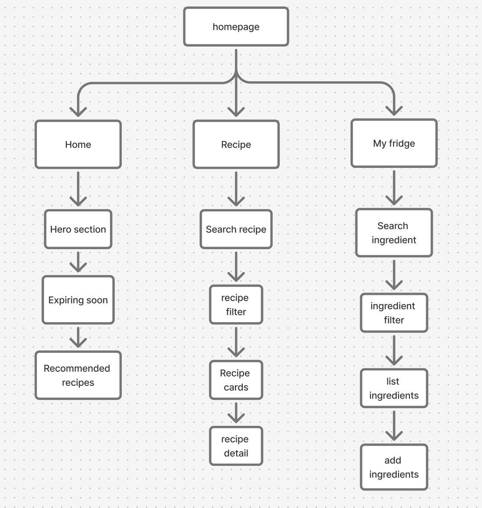

# Frio — Cook More, Waste Less

## Project Concept

Frio is a responsive recipe and fridge management website that helps users discover recipes using ingredients they already have at home.

The goal is to make cooking easier, reduce food waste, and help users prepare meals without buying extra groceries.

## Main Pages

**1. Home**
- Hero section
- Can Make Now recipes
- Expiring ingredients
- Recommended recipes

**2. Recipes**
- Search recipes
- Filter by meal type (Breakfast, Lunch, Dinner)
- Find recipes based on available ingredients
- View recipe details

**3. My Fridge**
- View ingredients
- Check expiration dates
- Add or edit ingredients

## Design Approach

Frio is designed with a mobile-first approach. I will build the mobile layout first, then adapt it to desktop screens using CSS media queries.

The visual design uses warm colors, food photography, and simple navigation.

## Wireframe & Sitemap
